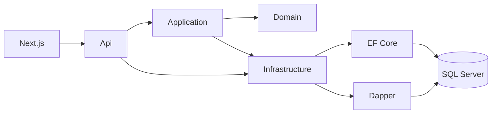

# Arquitectura

El navegador usa el frontend de Next.js. El frontend llama a la API por HTTP. La API no contiene reglas de torneo: orquesta idempotencia, trazas y el mapeo de `Result` a códigos HTTP.

## Capas

| Capa | Responsabilidad |
| --- | --- |
| Domain | Equipos, jugadores, partidos, goles y el cálculo de la tabla. No depende de nadie. |
| Application | Comandos y consultas. Define los puertos: repositorios, Unit of Work y consultas de lectura. |
| Infrastructure | EF Core, Dapper, idempotencia y la semilla. |
| Api | Controladores, Swagger, CORS, correlación e idempotencia HTTP. |

## CQRS

Los comandos crean o cambian equipos, jugadores, partidos y resultados. Pasan por un handler, persisten con EF Core y confirman con Unit of Work. `SaveChanges` no se llama fuera de esa unidad de trabajo.

Las consultas de equipos, jugadores, partidos, tabla y goleadores van por Dapper. El `ORDER BY` sale de una lista blanca. `pageNumber` y `pageSize` se aplican con `OFFSET/FETCH` en SQL. La respuesta de cada GET es `data`, `pageNumber`, `pageSize`, `totalRecords` y `totalPages`.

## Unit of Work

`UnitOfWork.CommitAsync` abre la transacción, guarda los cambios de todos los repositorios del comando y, si el guardado falla, devuelve un `Result` de conflicto. Los eventos de dominio se despachan en ese mismo commit.

## Idempotencia

El middleware lee `Idempotency-Key` en cada POST. Guarda la clave, el hash del cuerpo y la respuesta cuando el estado es menor a 500. Repetir la clave con el mismo cuerpo devuelve esa respuesta. Repetirla con otro cuerpo devuelve 409.

## Eventos

`TeamCreated` se emite al crear un equipo. `MatchResultRegistered` se emite al registrar un resultado. No hay un broker externo: Infrastructure escribe el evento en el log, con el identificador de traza.

## Logs y traza

Serilog escribe JSON en la consola. El middleware de correlación toma `X-Correlation-Id` o genera uno, lo deja en el log y lo devuelve en la respuesta. Cada request registra método, ruta, estado y duración.

## Frontend y Docker

Next.js tiene una carpeta por módulo para pantallas, hooks y servicios. El cliente HTTP envía `Idempotency-Key` en cada POST.

`docker compose up --build` levanta SQL Server, la API y el frontend. La API espera el healthcheck de la base, migra y siembra si no hay equipos.
